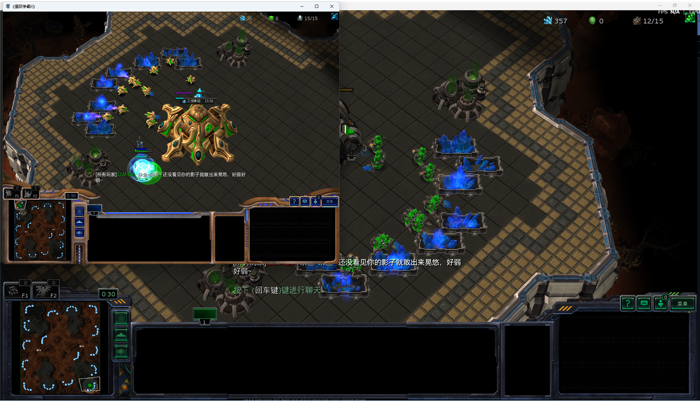

# 星际争霸 II · 本地 LLM 对手

你打人类客户端，对手是一个由本地大模型决定战术的神族 bot。模型只负责宏观决策和嘴炮，单位操作交给确定性脚本。



## 快速开始

环境已经配好（Python 3.12 虚拟环境 + python-sc2 7.3.0 + llama.cpp）。

1. **启动模型服务**：双击 `run_llm.bat`，等窗口出现 `server is listening on http://127.0.0.1:8080`。首次加载模型约 20~60 秒。
2. **开始对局**：双击 `run_game.bat`。框架会拉起两个星际客户端，十几秒后进入游戏。

第一次进游戏时，人类客户端（带 `You` 名字的那个）需要你正常操作进入对局。

## 参数

```bat
run_game.bat --me protoss --map kingscove --interval 30
```

| 参数 | 默认 | 说明 |
| --- | --- | --- |
| `--map` | `kairos` | `kairos` / `kingscove` / `newrepugnancy` |
| `--me` | `terran` | 你玩什么族：`protoss` / `terran` / `zerg` |
| `--bot-race` | `protoss` | bot 目前只实现了神族 |
| `--interval` | `20` | 每多少秒向模型要一次决策 |
| `--no-llm` | 关 | 不接模型，按默认打法跑，用来单独验证 bot |
| `--llm-url` | `http://127.0.0.1:8080/v1/chat/completions` | OpenAI 兼容接口地址 |
| `--replay` | `replays/last.SC2Replay` | 对局结束后的回放路径 |

## 目录结构

| 文件 | 作用 |
| --- | --- |
| `main.py` | 入口，用 python-sc2 开人类 vs bot 的对局 |
| `bot.py` | 执行层：补农民、造人口、开局建筑、出兵、侦察、进攻/防守 |
| `brain.py` | 决策层：后台线程定时请求模型，解析 JSON 指令和台词 |
| `run_llm.bat` | 启动本地 llama.cpp 服务 |
| `run_game.bat` | 启动对局 |
| `docs/report.md` | 技术报告（架构、关键决策、实测数据、局限） |
| `llama-server.log` | llama-server 日志，显存 / 速度问题先看这里 |

## 它是怎么打的

- **手**：`bot.py` 每局固定流程，水晶塔 → 传送门 → 控制核心 → 二兵营 → 气矿 → 开矿，农民补到每矿 20 个。
- **脑**：`brain.py` 每 20 秒收到一次局势摘要（人口、农民、基地、矿气、部队构成、可见敌兵），模型返回打法和一句台词。

模型服务没起来时，`main.py` 会直接报错退出，不会让 bot 闷头用默认打法打完整局。

## 它会说什么

| 时机 | 内容 |
| --- | --- |
| 开局第 5 秒 | 打招呼，例如「杂鱼~ 又来送头了吗？」 |
| 每 20 秒 | 模型生成的雌小鬼嘲讽 |
| 快输了（基地被围 / 兵力崩盘） | 求饶，最多 4 次，间隔 25 秒 |
| 基地全掉 | 打 GG |
| 对局结束判定失败 | 再补一句 GG（`on_end` 兜底） |

台词之间有 6 秒冷却，星际对过密的聊天会直接丢包。

## 常见问题

**模型加载失败 / 显存爆了**

改 `run_llm.bat` 里的 `-ngl 36`，调小到 28 或把 `-c 4096` 降到 2048。6 GB 显存跑 9B Q4 本来就紧。

**bot 太菜**

先调 `bot.py` 的 `_build_order`：把兵营上限从 4 提到 6，或降低 `attack_at_army`。目前执行层没有微操，打不过正常运营的人类是预期内的。

**决策太慢**

正常一次决策 2~4 秒。如果慢到几十秒甚至超时，先看 `llama-server.log`：

- 出现两个 `llama-server.exe` 在抢 8080 → 只留一个，`run_llm.bat` 已自动清理旧进程。
- `n_slots` 大于 1 → 多槽共享上下文会让提示词反复重算，必须保持 `--parallel 1`。
- 同时开了两局 `main.py` → 关掉多余的那局。

**想换模型**

`run_llm.bat` 里换 `MODEL` 路径即可，任何 llama.cpp 能加载的 GGUF 都行，接口是 OpenAI 兼容的。

## 环境

- Windows + 已安装《星际争霸 II》（当前 `E:\StarCraft II`）
- Python 3.12（`.venv` 已包含 python-sc2）
- NVIDIA GPU，6 GB 显存以上
- `E:\llama.cpp\llama-server.exe` + GGUF 模型
